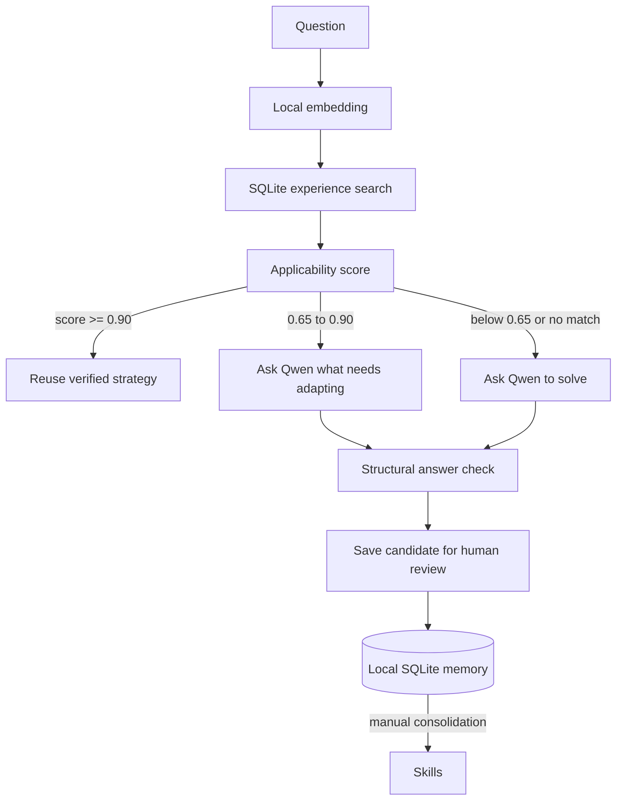

# Experience AI Runtime

**Reuse verified solutions before asking a local model to reason again.**

[](https://github.com/supermemeseveryday-star/experience-ai-runtime/actions/workflows/ci.yml)
[](https://www.python.org/)
[](LICENSE)
[](#privacy)

**[简体中文](README_zh.md)**

If reusable local experience is useful to you, a star or a small, focused contribution helps others find and improve the project.

Experience AI Runtime is an experimental, local-first reasoning layer for Ollama. It retrieves compact problem-solving experiences from SQLite, checks whether they apply, and chooses to reuse, adapt, or solve with a local model. Memory and routing stay independent from model weights.

> **This is an application framework, not a new set of Qwen weights.** Ollama runs the model; Experience AI handles retrieval, routing, reviewable memory, and metrics.

## Why it exists

Repeated problems often trigger repeated model calls. A verified experience can capture the useful strategy and verification steps once, then make them available to later, similar questions. Similarity alone never permits reuse: only `VERIFIED` and `TRUSTED` experiences are eligible.

## Quick start

Requirements: Python 3.11+, [Ollama](https://ollama.com/), and a local Qwen model. This checkout uses the Ollama model `qwen3.8:27b-mtp-q4_K_M` (about 18 GB, Q4); the Modelfile sets a 32K context for a more practical memory footprint on a 64 GB Mac. This is the 27B Qwen3.8 model, not the much larger 125B Flash-Next variant.

```bash
# Clone the repository
git clone https://github.com/supermemeseveryday-star/experience-ai-runtime.git
cd experience-ai-runtime

# Install the app and test tools
python3 -m venv .venv
source .venv/bin/activate
pip install -e '.[test]'

# Start Ollama in another terminal, then install the model explicitly
ollama serve
ollama pull qwen3.8:27b-mtp-q4_K_M

# Build the local Experience AI Ollama alias and check the setup
ollama create experience-ai -f Modelfile
experience-ai health

# Chat through the Experience AI framework
experience-ai chat
```

The project never downloads a reasoning model automatically. `Modelfile` creates a local Ollama alias from the Qwen model you installed; it does not fine-tune or modify Qwen weights.

## What happens to a query



The chat output exposes `REUSE`, `PARTIAL_REASONING`, or `DEEP_REASONING`, along with the matched experience, similarity, and applicability. Thresholds and score weights are configurable in `config/settings.yaml`.

### Experience lifecycle

1. A new or adapted answer may produce a `CANDIDATE` experience.
2. Inspect candidates with `experience-ai candidates`.
3. Independently complete the listed verification, then run `experience-ai verify <id>` and confirm.
4. The resulting `VERIFIED` experience can be reused on a later applicable query.
5. `experience-ai consolidate` can generalize multiple verified experiences into a skill.

The built-in validator only checks that an answer is non-empty. Human or domain-specific verification is required before experience promotion; the runtime does not claim that a model-generated answer is factually proven.

## Features

- **Local model adapter:** Ollama HTTP API; no hosted or paid LLM APIs.
- **Persistent experience memory:** SQLAlchemy and SQLite, with experience status, confidence, strategy, checks, and usage history.
- **Applicability-aware retrieval:** cosine similarity plus conditions, confidence, observed success, and freshness.
- **Adaptive routing:** verified reuse, partial reasoning, or deep reasoning.
- **Offline embeddings:** deterministic hashed-token and character n-gram fallback, including Chinese text. Optional local-only Sentence Transformers support is available when its model files are already cached.
- **Review before reuse:** extracted experiences remain candidates until independently verified.
- **Local API:** FastAPI endpoints and a local OpenAI-compatible `/v1/chat/completions` endpoint.
- **Observable behavior:** request mode, latency, selected experience, and validation status are recorded locally.
- **Controlled learning:** ingest a local JSONL dataset; no automatic web scraping.

## Commands

```bash
experience-ai health
experience-ai chat
experience-ai learn --file data/problems.jsonl
experience-ai candidates
experience-ai verify exp_0123
experience-ai consolidate
experience-ai benchmark --file data/problems.jsonl
experience-ai serve
```

Run commands from the repository root so `config/settings.yaml` and `data/experience.db` resolve as expected. `experience-ai serve` binds to `127.0.0.1:8000` by default.

## Local API

Available endpoints: `GET /health`, `POST /chat`, `GET /experiences`, `GET /experiences/{id}`, `POST /experiences`, `GET /skills`, `GET /metrics`, `GET /settings`, `POST /benchmark`, and `POST /v1/chat/completions`.

```bash
curl http://127.0.0.1:8000/v1/chat/completions \
  -H 'Content-Type: application/json' \
  -d '{"model":"experience-ai","messages":[{"role":"user","content":"How do I convert a video to 9:16?"}]}'
```

The API has no authentication in this MVP. Keep it on localhost unless you add a suitable network and authentication boundary.

## Benchmark honestly

```bash
experience-ai benchmark --file data/problems.jsonl
```

The benchmark compares direct model calls with runtime calls and reports latency, experience hits, reuse rate, and deep-reasoning rate. The included 44 questions are synthetic and unlabeled, so the runner does **not** report accuracy. Token usage is currently unavailable and reported as zero. Add labeled expected answers and a domain evaluator before drawing quality or compute-saving conclusions.

## Development

```bash
uv sync --extra test --extra dev
uv run ruff format src tests
uv run ruff check src tests --select E4,E7,E9,F --ignore E701,E702
uv run pytest -q
```

Unit tests use a fake provider and need no Ollama or network. GitHub Actions runs formatting, lint, and tests on Python 3.11–3.14.

See [CONTRIBUTING.md](CONTRIBUTING.md), [SECURITY.md](SECURITY.md), and [SUPPORT.md](SUPPORT.md) to help out or report an issue.

## Privacy

Questions, experiences, embeddings, and metrics stay in the local SQLite database. Requests are sent only to the locally configured Ollama server. The project has no telemetry or cloud sync. Do not expose the API publicly without adding authentication.

## Current limitations

- This is an experimental MVP; answer validation does not establish factual correctness.
- The fallback embedding is lightweight lexical hashing, not a transformer-grade semantic model. Sentence Transformers are optional and load only from local files.
- Experience promotion is a human review step.
- Benchmark accuracy and token counts need a labeled evaluator and provider token accounting.
- Skills are consolidated with simple grouping heuristics.

See [the roadmap](docs/ROADMAP.md) for planned work. Contributions that improve retrieval evaluation, domain verification, onboarding, and cross-platform reliability are especially welcome.

## License and model terms

The framework code is licensed under [MIT](LICENSE). Qwen and Ollama are separate projects; their licenses and terms apply to their respective software and model weights. No model weights are included in this repository.
