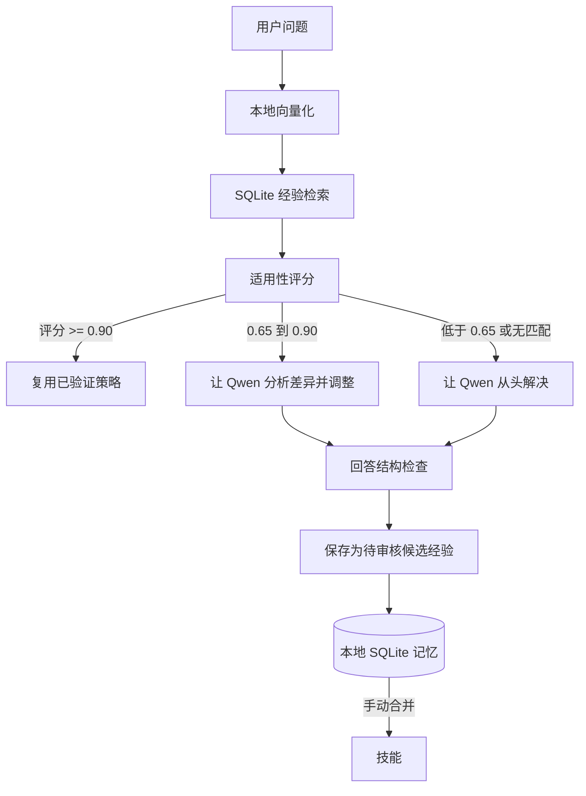

# Experience AI Runtime

**先复用已验证的经验，再让本地模型重新推理。**

[](https://github.com/supermemeseveryday-star/experience-ai-runtime/actions/workflows/ci.yml)
[](https://www.python.org/)
[](LICENSE)

**[English](README.md)**

如果你觉得本地经验复用的思路有用，欢迎点 Star 或提交小而具体的改进，帮助更多人发现并完善项目。

Experience AI Runtime 是一个实验性的本地优先推理框架，适配 Ollama。它从 SQLite 检索精简的问题解决经验，检查这些经验是否适用于当前问题，并决定复用、部分调整，或交给本地模型从头解决。经验记忆和推理路由独立于模型权重。

> **这是应用框架，不是新的 Qwen 权重。** Ollama 运行模型；Experience AI 负责检索、路由、可审核的经验记忆和指标记录。

## 为什么做这个项目

相似问题往往会触发重复的模型调用。经过验证的经验可以保存有效策略和检查步骤，供后续类似问题使用。但系统不会仅凭相似度复用：只有 `VERIFIED` 和 `TRUSTED` 状态的经验才可自动复用。

## 快速开始

需要 Python 3.11+、[Ollama](https://ollama.com/) 和一个本地 Qwen 模型。本项目使用 `qwen3.8:27b-mtp-q4_K_M`（约 18 GB，Q4），Modelfile 将上下文设为 32K，以便在 64 GB Mac 上更实际地运行。注意：这是 Qwen3.8 27B，并非更大的 125B Flash-Next。

```bash
git clone https://github.com/supermemeseveryday-star/experience-ai-runtime.git
cd experience-ai-runtime
python3 -m venv .venv
source .venv/bin/activate
pip install -e '.[test]'

# 在另一个终端启动 Ollama，并明确安装本地模型
ollama serve
ollama pull qwen3.8:27b-mtp-q4_K_M

# 创建本地 Experience AI Ollama 别名并检查环境
ollama create experience-ai -f Modelfile
experience-ai health

# 通过 Experience AI 框架聊天
experience-ai chat
```

项目不会自动下载推理模型。`Modelfile` 基于你已安装的 Qwen 模型创建本地 Ollama 别名，不会微调或修改 Qwen 权重。

## 查询处理流程



聊天结果会显示 `REUSE`、`PARTIAL_REASONING` 或 `DEEP_REASONING`，以及匹配经验、相似度和适用性。阈值和评分权重在 `config/settings.yaml` 中配置。

### 经验生命周期

1. 新回答或调整后的回答可能生成 `CANDIDATE` 经验。
2. 用 `experience-ai candidates` 查看候选经验。
3. 独立完成经验列出的验证，再运行 `experience-ai verify <id>` 并确认。
4. 经验升级为 `VERIFIED` 后才可自动复用。
5. `experience-ai consolidate` 可以把多个已验证经验归纳为技能。

内置校验器目前只检查回答是否为空，不能证明事实正确。经验升级前必须经过人工或领域校验。

## 功能

- **本地模型适配器：** 通过 Ollama HTTP API 调用，不使用托管或付费大模型 API。
- **持久化经验记忆：** SQLAlchemy + SQLite，保存经验状态、置信度、策略、验证方法和使用统计。
- **适用性检索：** 综合余弦相似度、条件兼容性、置信度、历史成功率和新鲜度。
- **自适应路由：** 复用已验证经验、部分推理或深度推理。
- **离线向量化：** 默认使用确定性的 token 哈希和字符 n-gram，也支持中文；Sentence Transformers 是可选依赖，并且只从本地已有文件加载。
- **审核后复用：** 新经验先作为候选，独立验证后才能启用。
- **本地 API：** FastAPI 接口和兼容 OpenAI 请求格式的 `/v1/chat/completions`。
- **可观测性：** 在本地记录推理模式、延迟、选中经验和校验状态。
- **受控学习：** 从本地 JSONL 数据读取问题，不自动抓取互联网。

## 命令

```bash
experience-ai health
experience-ai chat
experience-ai learn --file data/problems.jsonl
experience-ai candidates
experience-ai verify exp_0123
experience-ai consolidate
experience-ai benchmark --file data/problems.jsonl
experience-ai serve
```

请从项目根目录运行，以便正确解析配置和数据库路径。`experience-ai serve` 默认监听 `127.0.0.1:8000`。

## 本地 API

支持 `GET /health`、`POST /chat`、`GET /experiences`、`GET /experiences/{id}`、`POST /experiences`、`GET /skills`、`GET /metrics`、`GET /settings`、`POST /benchmark` 和 `POST /v1/chat/completions`。

```bash
curl http://127.0.0.1:8000/v1/chat/completions \
  -H 'Content-Type: application/json' \
  -d '{"model":"experience-ai","messages":[{"role":"user","content":"How do I convert a video to 9:16?"}]}'
```

MVP 暂无 API 身份验证。除非自行增加网络隔离和身份验证，否则请仅在本机开放服务。

## 基准测试

```bash
experience-ai benchmark --file data/problems.jsonl
```

基准测试对比直接模型调用与运行时调用，报告延迟、经验命中率、复用率和深度推理率。内置 44 个合成问题没有标签，因此不会报告准确率；当前也没有模型 token 统计，token 数显示为 0。要评估质量或计算节省，请先加入标注答案和领域评估器。

## 开发

```bash
uv sync --extra test --extra dev
uv run ruff format src tests
uv run ruff check src tests --select E4,E7,E9,F --ignore E701,E702
uv run pytest -q
```

单元测试使用假模型，不需要 Ollama 或网络。GitHub Actions 会在 Python 3.11–3.14 上运行格式检查、lint 和测试。

欢迎阅读 [贡献指南](CONTRIBUTING.md)、[安全策略](SECURITY.md) 和 [支持说明](SUPPORT.md)。

## 隐私

问题、经验、向量和指标保存在本地 SQLite 数据库中。请求只发送给本地配置的 Ollama 服务。项目没有遥测或云同步。公开服务前请先增加身份验证。

## 当前限制

- 这是一个实验性 MVP；回答校验不能证明事实正确。
- 离线备用向量化是轻量词法哈希，不等同于 Transformer 级语义模型。Sentence Transformers 可选且只从本地加载。
- 经验升级需要人工审核。
- 准确率和 token 数需要标注评估器和模型 token 统计支持。
- 技能由简单规则合并。

计划见 [路线图](docs/ROADMAP.md)。欢迎改进检索评估、领域验证、上手体验和跨平台兼容性。

## 许可证和模型条款

框架代码使用 [MIT 许可证](LICENSE)。Qwen 和 Ollama 是独立项目，分别遵循各自的软件和模型许可。本仓库不包含模型权重。
